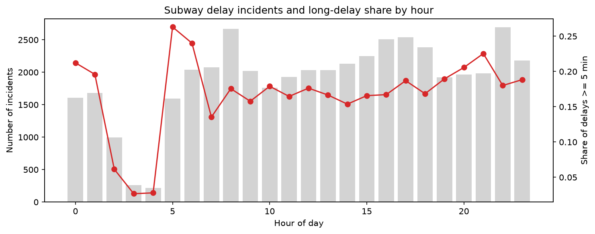

# TTC Subway Delay Prediction

Predicting whether a TTC subway delay incident will be long (≥ 5 min) using historical delay records from Toronto Open Data.

## Research Question

Given when, where and why a subway delay incident happens, can we predict whether it will cause a delay of 5 minutes or more?

## Key Results

- Best model: **logistic regression with a decision threshold tuned on a validation period**, reaching **F1 0.48** (precision 0.39, recall 0.61) on the held-out test period (May–Aug 2026). A majority-class baseline scores F1 0.
- Compared with class weighting, threshold tuning **halves the number of false alarms** (2,402 → 1,217).
- A more flexible random forest did **not** outperform logistic regression: most of the signal comes from the incident's cause code.
- **5–6 am** incidents have the highest long-delay rate (25%), and infrastructure failures account for **55%** of long delays in that window vs 14% at other times, consistent with overnight track work affecting the start of service.
- The long-delay rate **shifted between 2025 and 2026** (e.g. June: 20.9% → 14.3%), on top of a winter/summer seasonal pattern. This affects how well a model trained on the past transfers to the future.

## Data

- Source: [Toronto Open Data — TTC Subway Delay Data](https://open.toronto.ca/dataset/ttc-subway-delay-data/), January 2025 to August 2026 (45,475 incidents). Contains information licensed under the Open Government Licence – Toronto.
- Data is not included in this repo. Download these two CSV files from the dataset page and place them in `data/raw/`:
  - `TTC Subway Delay Data since 2025`
  - `Code Descriptions`

## Method

**1. Data cleaning** (`notebooks/01_eda.ipynb`)
- **Station names:** 1,251 raw values → 86 categories. The source truncates names at 22 characters (e.g. `PIONEER VILLAGE STATIO`) and mixes in platform notes, line-wide notices, segments between stations and typos. Rule-based cleaning maps these back to stations or to catch-all groups (`LINE-WIDE`, `BETWEEN`, `YARD`, `OTHER`).
- **Lines:** inconsistent spellings unified into `YU`, `BD`, `SHP` and `MULTI`; 177 missing values filled from the station's most common line; 21 non-subway records (bus routes, the closed SRT) dropped.
- **Cause codes:** 140 codes grouped by prefix (`EU` vehicle equipment, `PU` infrastructure, `SU` security, `TU` operations staff, `MU` miscellaneous); codes with fewer than 100 incidents merged into `<prefix>_OTHER`.
- **Time features:** hour grouped into time-of-day periods (the hourly pattern is not linear), plus weekday, month, weekend and rush-hour flags.
- **Leakage check:** `Min Gap` (gap between trains) was excluded. It is recorded together with the delay and correlates 0.83 with delay length.

**2. Modeling** (`notebooks/02_modeling.ipynb`)
- **Target:** `long_delay = 1` if the delay is ≥ 5 minutes (18% of incidents). The 5-minute threshold gives better class balance than 10 minutes (5.8%).
- **Time-based split:** train on the earliest 80% of incidents (Jan 2025 – May 12, 2026), test on the latest 20% (May 12 – Aug 31, 2026). A random split would let the model see the future during training.
- **Models:** majority-class baseline, logistic regression and random forest, with and without balanced class weights. Categorical features are one-hot encoded inside a scikit-learn `Pipeline`.
- **Threshold tuning:** the last part of the training period (Feb 12 – May 12, 2026) is held out as a validation set to choose the probability threshold, so the test set is used only once.
- **Metrics:** precision, recall and F1 on the long-delay class. Accuracy is misleading here: always predicting "not long" already reaches 86%.

## Results

Test period: May 12 – Aug 31, 2026 (9,091 incidents, 14.3% long delays).

| Model | Accuracy | Precision | Recall | F1 |
|---|---|---|---|---|
| Majority baseline | 0.857 | 0.000 | 0.000 | 0.000 |
| Logistic regression | 0.862 | 0.526 | 0.300 | 0.382 |
| Logistic regression (balanced) | 0.709 | 0.305 | 0.814 | 0.444 |
| Random forest | 0.863 | 0.584 | 0.140 | 0.225 |
| Random forest (balanced) | 0.695 | 0.294 | 0.812 | 0.431 |
| **Logistic regression (threshold 0.30)** | 0.810 | **0.393** | 0.608 | **0.477** |



**What the model learned.** The largest positive coefficients belong to the causes with the highest long-delay rates in the data (injured customer on a train, track switch failure, rail problems). The largest negative ones belong to records that are not train delays at all (no collector available, escalator or stairway incidents, planned closures). Line-wide and multi-line records also lower the prediction: 99.6% and 100% of them have a 0-minute delay, so they are mostly notices rather than disruptions.

## Limitations

- Records are self-reported incident logs, not measured delays. 65% have a 0-minute delay, and several codes describe events that do not affect trains.
- The data has no ridership, train frequency or exposure information, so a busy station having more incidents does not mean it is riskier.
- The long-delay rate in the test period is lower than in training (seasonality plus a 2026 shift), which lowers test performance; validation F1 was 0.50 vs 0.48 on test.
- Rare-category grouping and line imputation were computed on the full dataset. They do not use the target, so the effect should be small, but strictly they should be fit on the training set only.
- About 1.4% of incidents could not be mapped to a station and are grouped as `OTHER`. `Bound` (35% missing) and `Vehicle` are not used.

## Next Steps

- Evaluate the model only on incidents that affect train service, excluding codes that are never delays.
- Add weather data to test whether the winter peak is driven by weather.
- Try gradient boosting and probability calibration.
- Predict the number of delays per station and hour as a time-series problem.

## Setup

```bash
python -m venv .venv
source .venv/bin/activate      # Windows: .venv\Scripts\activate
pip install -r requirements.txt
```

Run `notebooks/01_eda.ipynb` first (it writes `data/processed/delays_clean.csv`), then `notebooks/02_modeling.ipynb`.

## Project Structure

```
├── data/              # not tracked; see Data above
│   ├── raw/
│   └── processed/
├── figures/           # charts used in this README
├── notebooks/
│   ├── 01_eda.ipynb       # exploration, cleaning, feature engineering
│   └── 02_modeling.ipynb  # baseline, models, threshold tuning, results
├── requirements.txt
└── README.md
```

## Acknowledgements

Developed with assistance from Claude (Anthropic) for code and explanations. Analysis decisions and interpretation are my own.